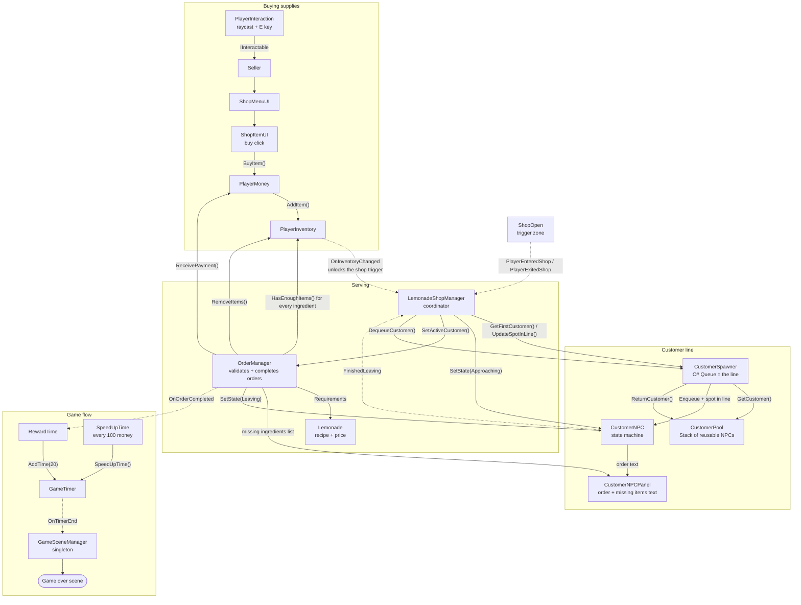
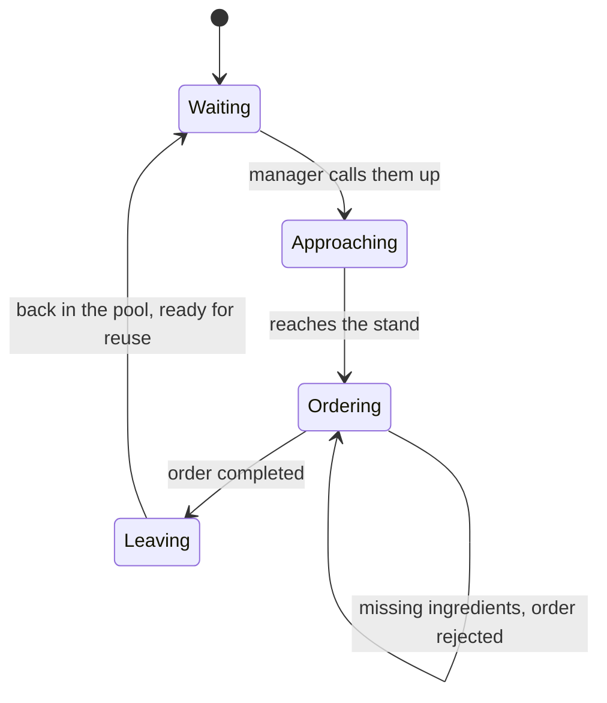

# Lemonade-Simulator
Lemonade Simulator Mini-Game, I built it just to iron out my systems architecture fundamentals some more. lets get this done!

The main goal of this project was to get hands-on experience building interconnected gameplay systems and understanding how to make them work together without having everything tightly interconnected and harder to maintain/scale overall. The main goal was to maintain code modularity and keep everything as loosely connected as possible to leave room for newer features.

Some of the systems I've been working on:

**Customer Queue System:** Managing customer order and positioning using C# queues, alongside object pooling to reuse customer NPCs instead of constantly instantiating new ones.

**Customer Behaviour:** Managing customer interactions through different states, including waiting, approaching, ordering, and leaving.

**Inventory System & Order Validation:** Checking ingredient requirements before processing orders, including identifying multiple missing ingredients instead of stopping at the first unavailable item.

**Event-Driven Decoupling:** Using C# events to notify other systems when certain gameplay events occur, keeping systems from relying too heavily on direct communication.

**Game Flow:** Handling order progression, countdown timers, game-over conditions, and scene transitions.

## How it all fits together

Solid arrows are direct method calls. Dotted arrows are C# events, where the sender doesn't know or care who's listening.

### Customer states

**What I'm focusing on**

Beyond getting the game working, I want to understand the reasoning behind how systems are structured, how they communicate, and how to keep code maintainable as a project grows.

This project has been a practical way to experiment with C#, OOP, system responsibilities, and solving the little problems that come with making different gameplay systems work together.

Key scripts to take a look at:
- OrderManager.cs
- CustomerNPC.cs
- CustomerPool.cs
- CustomerSpawner.cs
- ShopItemMenu.cs
- Ingredients.cs
